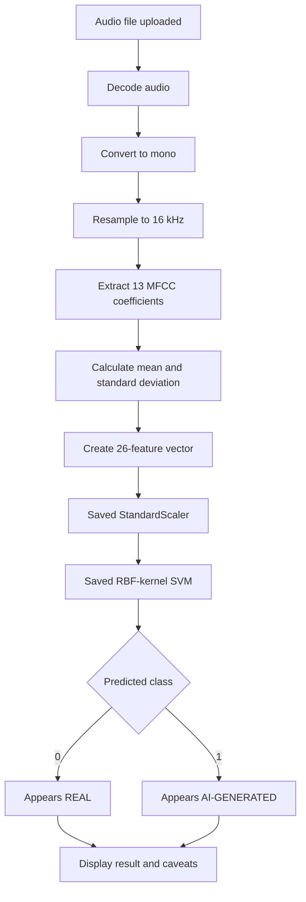
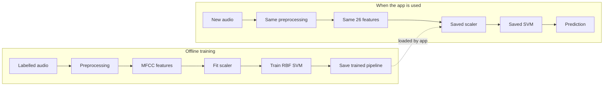
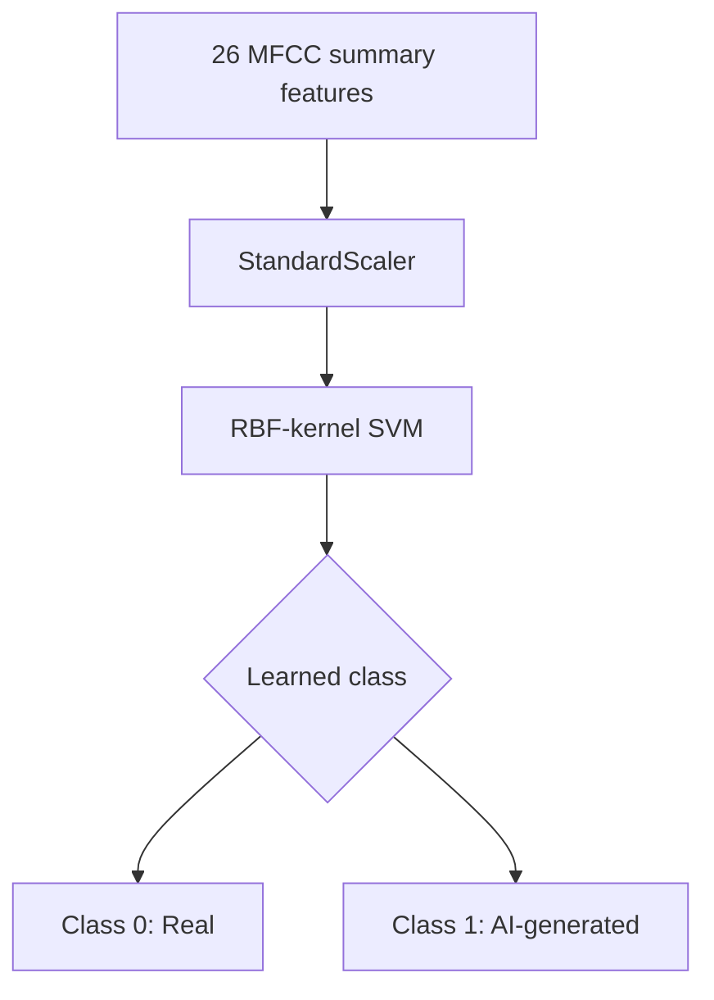
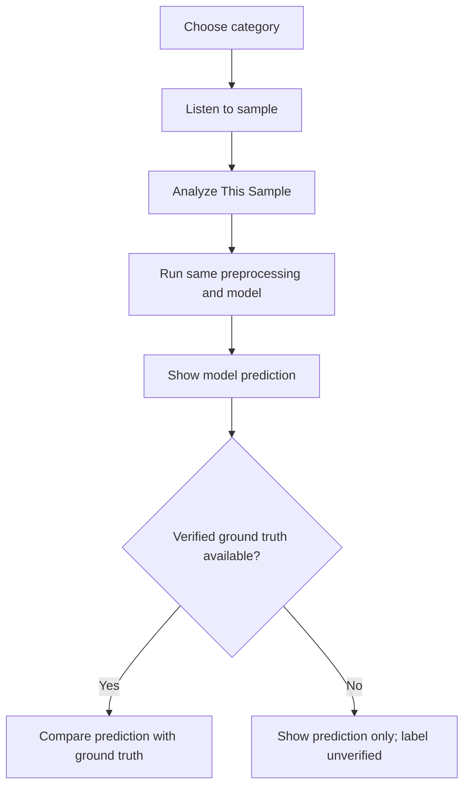

# Acoustic Reality Intelligence (ARI v2.0)
### AI-powered environmental audio analysis and synthetic-sound assessment

Acoustic Reality Intelligence (ARI) is a Streamlit application that preprocesses environmental audio, extracts MFCC-derived features, and uses an experimental Support Vector Machine (SVM) to estimate whether a recording resembles the real or AI-generated examples used during training.

> **Important limitation:** ARI is an experimental general-environmental-audio classifier. It is not an independently validated human-voice or AI voice-clone detector. Predictions can be wrong, particularly for unfamiliar sound types, speech, cloned voices, and recordings unlike the training data.

## Contents
- [What ARI does](#what-ari-does)
- [Application navigation](#application-navigation)
- [How the analysis works](#how-the-analysis-works)
- [The SVM model](#the-svm-model)
- [Try Sample Audio](#try-sample-audio)
- [Supported audio](#supported-audio)
- [Model integrity and class mapping](#model-integrity-and-class-mapping)
- [Project structure](#project-structure)
- [Installation and launch](#installation-and-launch)
- [Tests](#tests)
- [Limitations](#limitations)
- [Credits and provenance](#credits-and-provenance)

## What ARI does
- Accepts environmental audio uploads and inspects basic signal metadata.
- Decodes audio, converts it to mono, and prepares it at 16 kHz for inference.
- Extracts 26 MFCC-derived summary features.
- Applies a saved `StandardScaler` and RBF-kernel SVM.
- Includes bundled sample playback, one-click analysis, and a real-vs-generated comparison.
- Displays verified source labels separately from model predictions.
- Checks the saved model's SHA-256 fingerprint.

## Application navigation

| Page | Purpose |
|---|---|
| **Overview** | Introduction, audio upload/inspection, and Try Sample Audio |
| **Voice / Audio Detection** | Experimental real-vs-AI-generated audio assessment and exploratory tools |
| **About** | DSP foundations, model provenance, class mapping, and limitations |

## How the analysis works

The following Mermaid diagram renders directly on GitHub.



### Training versus app-time prediction



The model is trained beforehand. Normal app use loads the saved model; it does not retrain the SVM for every uploaded file.

## The SVM model

**MFCC** means Mel-Frequency Cepstral Coefficients. The project summarizes 13 MFCC coefficients over time using their mean and standard deviation:

\[
13\ \text{means} + 13\ \text{standard deviations} = 26\ \text{features}
\]

The scaler normalizes feature ranges. The RBF-kernel SVM learns a nonlinear decision boundary from labeled training examples. It then assigns a new feature vector to one of the learned classes.



This is a conceptual view. The actual model works in 26-dimensional feature space; a prediction is not proof of authenticity.

## Try Sample Audio

The Overview page includes **🎧 Try Sample Audio — Real vs AI-Generated**. Users can listen to available examples, analyze each sample, and compare selected real-labeled and AI-generated-labeled recordings.

### Bundled demonstration samples

| Category | Real / demo sample | AI-generated sample | Label status |
|---|---|---|---|
| Rain and Thunder | `sample_rain_thunder.wav` (3 s) | Unavailable in curated dataset | Real demo label unverified; generated pair unavailable |
| Birds and Insects | `envsdd_birds_real.mp3` (4 s) | `envsdd_birds_fake_audioldm.mp3` (4 s) | Verified Real / AI-generated |
| Siren and Alarm | `envsdd_siren_real.wav` (4 s) | `envsdd_siren_fake_audioldm.wav` (4 s) | Verified Real / AI-generated |

### Sample analysis and comparison flow



**Ground truth** is the label documented by the source dataset. **Prediction** is the output of ARI's SVM. They must be displayed separately. A mismatch is possible and should be shown honestly.

Source, label, generator, caption, and license details are recorded in `sample_audio/sample_manifest.json`. The Rain and Thunder demo is explicitly unverified, and no AI-generated counterpart is claimed. The project does not substitute procedural tones or noise and label them AI-generated.

## Supported audio

| Setting | Configuration |
|---|---|
| Formats | WAV, MP3, FLAC, OGG, M4A |
| Maximum file size | 25 MB per recording |
| Model input | 16 kHz mono |
| Feature vector | 26 MFCC-derived summary features |
| Signal checks | Flags extreme silence and digital clipping |

Audio is decoded and resampled for inference. The app may also display native sample-rate and bit-depth metadata.

## Model integrity and class mapping

**Model file:** `models/acoustic_model.joblib`

**Expected SHA-256:**
```text
b6d965c31ceba6a6be2483af2e378dead36f59a44ea97f5c3b3cf6f5a8160f91
```

The original notebook mapping is:

```python
y.append(1 if label == "fake" else 0)
```

| Class | Meaning | Display headline |
|---:|---|---|
| `0` | Real audio | `Your audio appears to be REAL` |
| `1` | AI-generated audio | `Your audio appears to be AI-GENERATED` |

A matching checksum confirms the model file matches the expected fingerprint; it does not prove that an individual prediction is correct.

## Project structure

```text
Acoustic_Reality_Intelligence_V2/
├── app.py
├── requirements.txt
├── README.md
├── models/
│   └── acoustic_model.joblib
├── sample_audio/
│   ├── sample_manifest.json
│   ├── sample_rain_thunder.wav
│   ├── envsdd_birds_real.mp3
│   ├── envsdd_birds_fake_audioldm.mp3
│   ├── envsdd_siren_real.wav
│   └── envsdd_siren_fake_audioldm.wav
├── tests/
│   └── ...
└── application modules/
```

The exact module layout may vary by project version.

## Installation and launch

Commands below are for **Windows PowerShell**.

### 1. Open the project folder

```powershell
cd "$HOME\Desktop\Acoustic_Reality_Intelligence_V2"
```

Change the path if your project is stored elsewhere.

### 2. Create and activate a virtual environment (recommended)

```powershell
python -m venv .venv
.\.venv\Scripts\Activate.ps1
```

### 3. Install dependencies

```powershell
python -m pip install -r requirements.txt
```

### 4. Launch the app

```powershell
python -m streamlit run app.py
```

Open the local URL printed by Streamlit, usually `http://localhost:8501`.

## Tests

Run the automated tests:

```powershell
python -m pytest tests/ -v
```

Run Python syntax checks:

```powershell
python -m compileall .
```

The project update report supplied for this version recorded 36 passing tests across eight test modules. Rerun the commands above to verify the exact checkout you are using; results may change after code or dependency updates.

## Limitations

1. **Experimental classifier:** the reported evaluation uses a limited environmental-audio dataset and does not guarantee performance on arbitrary recordings.
2. **Not a validated voice deepfake detector:** the model was not independently trained and validated for human speech or AI-cloned voices.
3. **Dataset coverage:** unfamiliar sound events, microphones, codecs, environments, and generation systems may produce different feature patterns.
4. **Feature summarization:** MFCC means and standard deviations may discard temporal detail that could help distinguish some recordings.
5. **Uncalibrated estimates:** any probability-like score displayed by the model should not be treated as a calibrated probability of authenticity.
6. **Ground-truth discipline:** only recordings with traceable source metadata should be described as verified real or AI-generated.
7. **No authenticity guarantee:** the model's output is an estimate based on learned patterns, not cryptographic proof that a recording is genuine or synthetic.

## Credits and provenance

- **EnvSDD:** Environmental Sound Deepfake Detection dataset and benchmark — [Hugging Face dataset](https://huggingface.co/datasets/AustinXiao/EnvSDD).
- **Clotho:** source of the real birds-and-insects recording identified in the sample manifest.
- **UrbanSound8K:** source of the real siren recording identified in the sample manifest.
- **AudioLDM:** text-to-audio generation model used for the documented generated examples.
- **Original ARI training notebook:** source of the preserved class mapping and trained model pipeline.

Refer to `sample_audio/sample_manifest.json` for per-file provenance and license details. Follow the original dataset and asset license terms when redistributing sample files.

---

## Academic demonstration summary

**Audio input → preprocessing → MFCC feature extraction → feature scaling → SVM classification → prediction → comparison with verified ground truth.**

ARI is an educational and experimental prototype. Present its limitations alongside its results.
